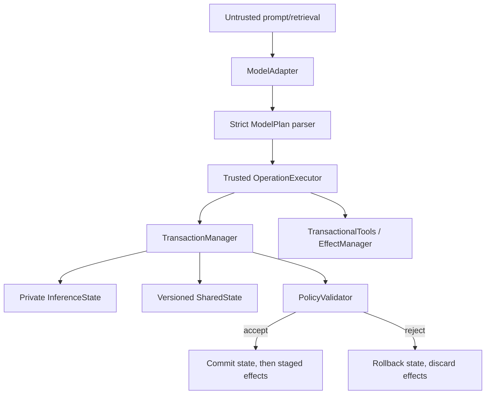

# Architecture

`runtime.py` is the core: state, sessions, snapshots, shared versions, events,
policies, and transaction lifecycle. `effects.py` adds simulated deferred
actions. `operations.py` maps fully parsed plans to scoped APIs. `model.py`
contains adapters above the core; the runtime never imports Ollama internals.
`integrity.py` provides canonical SHA-256. `benchmark.py`, `evaluation.py`,
`stage7.py`, and `reporting.py` measure and report rather than expand trusted
runtime authority.

Dependency direction is toward the core. Model adapters return text only.
External services are reachable only through an effect manager owned by the
transactional path. Evaluation code can instantiate the system but is not part
of the runtime safety mechanism.

See [repository map](21_repository_map.md) and the preserved
[trust boundary](../TRUST_BOUNDARY.md).

